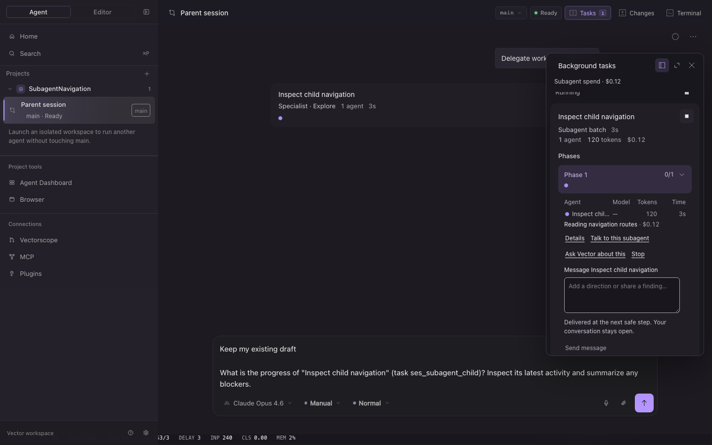
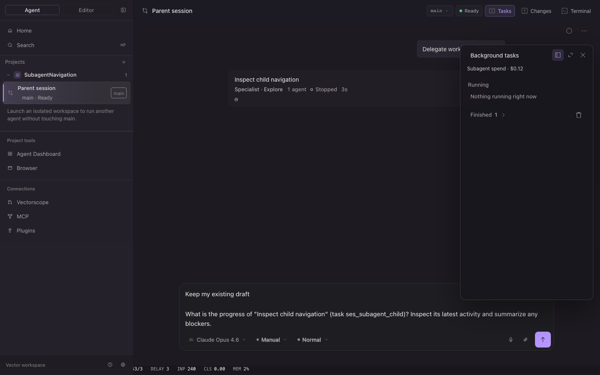

# App and desktop task experience validation

All UI scenarios use fixture data and local fake servers. No paid model requests or credentials are involved.

## Final functional checks

- App unit suite: 1,706 passed across 175 files (14.14 seconds).
- App browser unit suite: 46 passed across 14 files (1.68 seconds).
- Final full app Playwright suite: 127 passed, one existing `remote-tab-busy` skip, zero failures (6.5 minutes); see [browser-final.log](browser-final.log).
- App and browser-test TypeScript checks passed.
- Desktop focused adapter, mailbox, and swarm suite: 63 passed, 346 assertions.
- Engine bridge focused suite at its initial integration: 10 passed, 61 assertions. Later integration coverage is recorded in the parent validation report.

The first full browser attempt completed with 125 passes, one skip, and two failures. The external-agent draft case passed twice in an isolated rerun without a source change. The history-paging failure exposed an unsupported task-list response shape; the app now retains the last valid observations instead of assigning a missing array. The full timeline smoke and subagent scenario rerun passed all 12 tests. A subsequent review added per-source truncation retention so a failed desktop refresh cannot enable Stop all against an incomplete retained snapshot.

Original failures are retained in [browser-first-attempt.log](browser-first-attempt.log), followed by the [external draft rerun](external-draft-isolated-retry.log) and [timeline/subagent rerun](timeline-and-subagents-retry.log). An additional full attempt was deliberately interrupted after 11 passing scenarios to apply the truncation fix; it is not counted as a completed suite.

Run the functional checks from `packages/app`:

```sh
bun run test
GOMAXPROCS=2 bun typecheck
GOMAXPROCS=2 bun run typecheck:e2e
PLAYWRIGHT_PORT=4567 PLAYWRIGHT_WORKERS=1 bunx playwright test
```

## Visual checks

The active and stopped states were inspected after the controls scenario passed. The inline child composer preserves the parent draft, stays within the task pane, and keeps activity and measured spend visible. Ask Vector appends its question to the existing parent draft. Stop preserves partial output and shows a terminal state.





## Performance scope

The production timeline comparison uses the same fixture: 80 history turns, 40 streamed deltas, CPU throttle 4, review pane closed, one Chromium worker. It measures the existing conversation timeline, not a stress test of hundreds of live desktop workspaces. The baseline was captured before the app changes; its console metrics were recorded, but its raw log was not retained. No live-model latency, cache savings, quality, or cost claim follows from this UI benchmark.

Baseline: initial content observed at 432.125 ms; completion 10,113.2 ms; 40/40 deltas; RAF p95 9.2 ms, p99 9.3 ms, maximum 9.4 ms; no long tasks, row replacement, markdown replacement, blank samples, or viewport drift. The first attempted final build hit the existing 120-second server-start timeout while other checks were active; its output is retained in [production-build-timeout-attempt.log](production-build-timeout-attempt.log).

Final production comparison and the public-viewer suite are pending the shared build slot.

## Explicit boundaries

Desktop task spend is a separate subtotal of latest recorded workspace runs. It is not added to the native lifetime Session cost or native run-cap meter; unsupported usage remains unknown. Native ledger mirrors are excluded from the desktop subtotal.

Desktop control currently uses one authenticated long poll per retained real parent/project scope, including settled history. This preserves historical inspection but is not a measured large-history scaling solution. Coalesced polling or retention-aware registration remains follow-up work. Lease expiry is event-driven and does not claim that a disconnected executor stopped.
